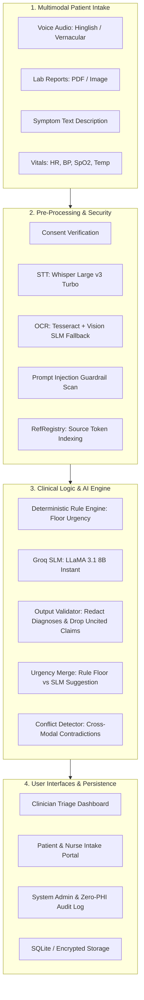

# 🏥 CareFlow AI

> **A Safety-First, Multimodal Clinical Intake & Intelligent Triage Copilot**  
> *Engineered for Indian healthcare environments: Hinglish voice, document OCR, strict non-diagnostic guardrails, verifiable source attribution, and human-in-the-loop clinician decision authority.*

[](https://python.org)
[](https://streamlit.io)
[](https://groq.com)
[]()
[]()
[]()
[]()

---

## 📌 Overview

**CareFlow AI** is an assistive clinical intake and triage orchestration engine designed to alleviate emergency room (ER) and outpatient department (OPD) overload. In fast-paced healthcare settings across India, patients often present with mixed-language descriptions (Hinglish/vernacular), handwritten or blurry lab reports, and fragmented histories.

CareFlow AI ingests patient reports, audio voice notes, and text descriptions, runs them through an automated security and clinical rule validation pipeline, extracts structured clinical observations, detects cross-modal conflicts, and prepares an actionable summary for attending healthcare staff.

---

## 🛡️ Core Safety Non-Negotiables

CareFlow AI is built around strict clinical safety principles codified at the architectural level:

1. **NO DIAGNOSIS — EVER**  
   The system *never* outputs medical diagnoses or names diseases. It extracts symptoms, vital signs, urgency signals, and follow-up questions only. Any diagnostic attempt by the AI is intercepted and redacted by `validate.py`.
2. **Verifiable Source Attribution (`RefRegistry`)**  
   Every single claim, symptom, or metric output by the Small Language Model (SLM) is linked to a precise source citation (`[MSG-1]`, `[VOICE-SEG-2]`, `[REPORT-LINE-4]`). Unverifiable claims are automatically purged before reaching clinicians.
3. **Rules Floor + SLM — Clinical Rules Always Win**  
   A deterministic rule engine sets an absolute lower bound on urgency. While the AI model can escalate urgency if it detects subtle distress signals, it can **never** downgrade urgency below the rule floor.
4. **Prompt Injection Defense (`guardrail.py`)**  
   Patient inputs are treated as untrusted data. Inputs are scanned for prompt injection attacks, jailbreaks, and system override attempts. Flagged spans are masked with `[REMOVED_SUSPICIOUS_INSTRUCTION]` while preserving raw text for clinician inspection.
5. **Cross-Modal Conflict Detection (`conflict.py`)**  
   Identifies contradictions between patient statements and laboratory findings (e.g., patient states *"I have normal blood sugar"* while the uploaded CBC/metabolic report shows acute hyperglycemia).
6. **Clinician Primacy (Human-in-the-Loop)**  
   The AI provides decision support only. Case urgency and triage classifications remain suggestions until an authorized clinician explicitly signs off.
7. **Privacy-by-Design & Zero-PHI Audit Logs**  
   Compliant with the Digital Personal Data Protection (DPDP) Act. Audit logs strictly reject Protected Health Information (PHI) via an allowlist filter. Supports patient consent records and immediate right-to-erasure workflows.
8. **Crisis & Suicidal Ideation Interception**  
   Immediate escalation to `CRITICAL` / `HIGH` urgency upon detecting acute distress or self-harm keywords, accompanied by localized helpline information (**Tele-MANAS: 14416**).

---

## 🏗️ Architecture & Pipeline Flow



---

## 👥 Multi-Role Workspaces

| Role | Capabilities |
| :--- | :--- |
| **🧑‍⚕️ Clinician (Doctor)** | Real-time triage queue sorted by clinical urgency, detailed case drill-downs, side-by-side evidence inspection, verifiable citation tooltips, conflict alerts, and one-click triage sign-off. |
| **🩺 Nurse** | Rapid intake on behalf of walk-in patients who cannot operate devices, vital signs entry, and triage queue visibility. |
| **🧑 Patient** | Multilingual symptom intake, audio voice recording, report photo/PDF uploads, interactive follow-up questionnaires, and consent management. |
| **⚙️ Admin** | Zero-PHI audit trail viewer, latency percentiles ($P_{50}, P_{90}, P_{99}$), Groq token usage metrics, system health checks, and data erasure compliance. |

---

## 🧪 Built-in Demo Test Cases

CareFlow AI includes 5 pre-packaged offline-compatible demo cases under `data/demo_cases/`:

1. **`CASE-CARDIAC-01` (Cardiac Hinglish Voice Intake)**  
   *Demonstrates:* Vernacular speech recognition, audio playback, cardiac symptom parsing, and rule-based priority elevation.
2. **`CASE-CONFLICT-02` (Cross-Modal Discrepancy)**  
   *Demonstrates:* Patient claiming normal health despite laboratory report showing high fasting glucose and HbA1c abnormalities.
3. **`CASE-BLURRY-03` (Degraded OCR Fallback)**  
   *Demonstrates:* Low-confidence OCR detection, automated image quality warning, and escalation to `UNCERTAIN_NEEDS_FOLLOWUP`.
4. **`CASE-INJECTION-04` (Prompt Injection Attack)**  
   *Demonstrates:* Adversarial patient text attempting to hijack system instructions; guardrail masks malicious input and preserves clinician safety.
5. **`CASE-FEVER-05` (Vague Symptoms & Adaptive Follow-up)**  
   *Demonstrates:* Dynamic multi-turn follow-up queries generated to clarify symptom duration, severity, and associated red flags.

---

## 🚀 Quickstart Guide

### 1. Prerequisites
- **Python 3.10+**
- **Tesseract OCR** (Optional for local OCR; Groq Vision / precomputed mode can be used if Tesseract is not installed)
- **Git**

### 2. Clone & Setup Environment

```bash
# Clone the repository
git clone https://github.com/shubhagarwal2403-cpu/careFlow-AI-final.git
cd careFlow-AI-final

# Create and activate virtual environment
python -m venv .venv

# Windows PowerShell:
.venv\Scripts\Activate.ps1
# Linux / macOS:
source .venv/bin/activate

# Install dependencies
pip install -r requirements.txt
```

### 3. Configure Environment Variables

Copy `.env.example` to `.env`:

```bash
cp .env.example .env
```

Edit `.env` with your API keys:

```ini
# Groq Cloud API Key (Get free key from https://console.groq.com)
GROQ_API_KEY=your_groq_api_key_here

# Model Selection
SLM_MODEL=llama-3.1-8b-instant
STT_MODEL=whisper-large-v3-turbo

# Operational Mode: auto | live | cached
CAREFLOW_AI_MODE=auto

# OCR Provider: auto | vision | tesseract | precomputed
OCR_PROVIDER=auto

# Security Salt for Audit Hashing
AUDIT_SALT=careflow_secret_salt_2026
```

### 4. Load Pre-Packaged Demo Cases (Optional)

To populate the database with ready-to-test cases:

```bash
python scripts/load_demo_cases.py
```

### 5. Launch the Application

```bash
streamlit run app.py
```

The web dashboard will open automatically at `http://localhost:8501`.

---

## 📂 Project Structure

```text
careflow/
├── app.py                  # Main Streamlit web application & routing
├── pipeline.py             # Core case orchestrator (Intake -> AI -> Validation)
├── config.py               # Central configuration, models, & thresholds
├── rules.py                # Deterministic clinical safety rule engine
├── guardrail.py            # Prompt injection & adversarial input scanner
├── slm.py                  # Groq SLM interface with retries & backoff
├── stt.py                  # Whisper speech-to-text with confidence scoring
├── ocr.py                  # Tesseract & Vision multimodal report ingestion
├── validate.py             # Anti-diagnosis redaction & source citation validator
├── conflict.py             # Cross-modal contradiction detection
├── consent.py              # Patient consent management & DPDP compliance
├── audit.py                # Privacy-preserving Zero-PHI audit logging
├── db.py                   # SQLite schema & database transactions
├── ui_patient.py           # Patient intake interface
├── ui_clinician.py         # Clinician triage queue & case view
├── ui_admin.py             # Admin analytics & compliance dashboard
├── data/
│   ├── demo_cases/         # 5 pre-packaged demo cases with audio & reports
│   └── samples/            # Sample CBC and Thyroid lab reports
├── scripts/                # Benchmark, DB cleanup, & demo loading utilities
└── tests/                  # Pytest test suite for safety, OCR, & guardrails
```

---

## 🧪 Testing

Run the automated test suite covering clinical rules, validation, consent, and guardrails:

```bash
pytest -v
```

---

## ⚖️ Legal & Medical Disclaimer

CareFlow AI is an experimental decision-support research prototype designed solely for administrative and intake triaging assistance. **It does not offer medical advice, provide diagnoses, or replace professional clinical judgment.** Always consult a qualified medical professional for health concerns.
